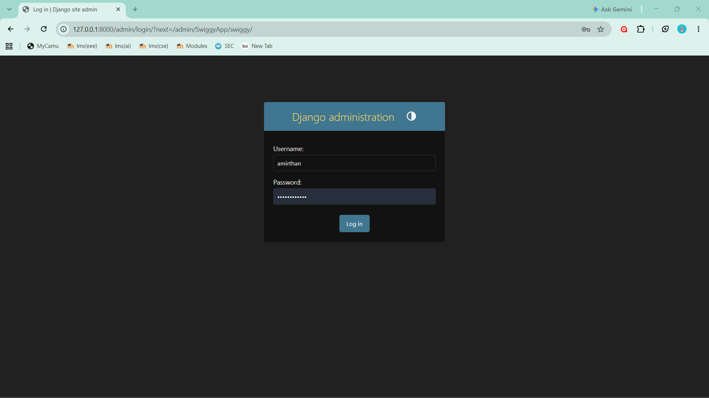
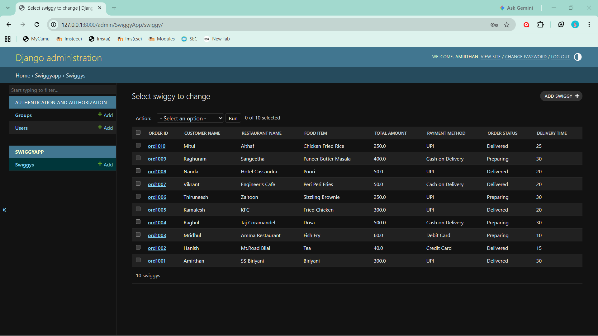

# Ex02 Django ORM Web Application
# Date: 20/11/2026
# AIM
To develop a Django application to store and retrieve data from a bank loan database using Object Relational Mapping(ORM).

# DESIGN STEPS
## STEP 1:
Clone the problem from GitHub

## STEP 2:
Create a new app in Django project

## STEP 3:
Enter the code for admin.py and models.py

## STEP 4:
Execute Django admin and create details for 10 cars

# PROGRAM
```
admin.py
from django.contrib import admin
from .models import Student, StudentAdmin
#Register your models here.
admin.site.register(Student,StudentAdmin)

models.py
from os import name
from django.db import models
from django.contrib import admin

class Student(models.Model):
    name = models.CharField(max_length=30)
    admnno = models.IntegerField()
    age = models.IntegerField()
    dob = models.DateField()
    sec = models.CharField(max_length=1)
    std = models.IntegerField()
    phno = models.IntegerField()
    bldgrp = models.CharField(max_length=3)

class StudentAdmin(admin.ModelAdmin):
    list_display = ('name', 'admnno', 'age', 'dob', 'sec', 'std', 'phno', 'bldgrp')
```
# OUTPUT



# RESULT
Thus the program for creating a database using ORM has been executed successfully
